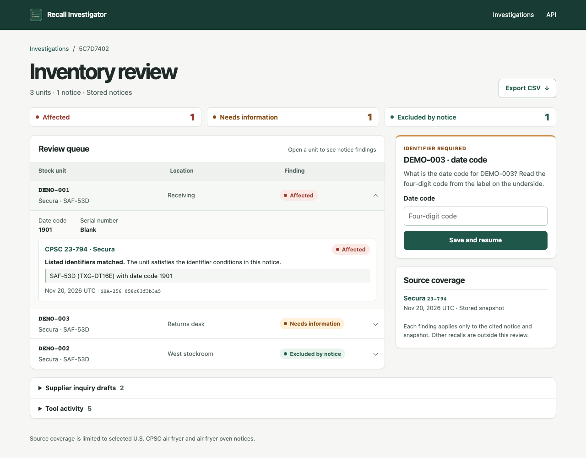
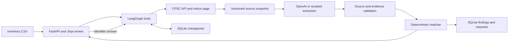

# Product Recall Impact Investigator

A local review tool for retailers that need to compare stock units against specific U.S. Consumer Product Safety Commission (CPSC) recall notices. Upload an inventory CSV, inspect the notice evidence for each unit, and supply missing identifiers to finish the review. The app exports findings and drafts supplier questions for manual use.



## Run the demo

Prerequisites are Python 3.12, [uv](https://docs.astral.sh/uv/), and Make.

```sh
make setup
make demo
```

Open [localhost:8000](http://127.0.0.1:8000), then select **Open sample investigation**. You can also upload [the synthetic inventory CSV](data/demo.csv) and select **Secura**. The first run produces one affected unit, one exclusion specific to this notice, and a date-code request for `DEMO-003`. Enter `1901` to resume. The review then has two affected units and one exclusion. Expand a unit for the evidence and source version, or download a CSV or the supplier drafts. See the [three-minute walkthrough](docs/demo.md) for a restart during this flow.

The CSV accepts `stock_id`, `brand`, `model`, `location`, and optional `date_code` and `serial_number` fields. It supports up to 400 units and 256 KB. Each row describes one stock unit. Identifier strings preserve zeros and punctuation. The review reports malformed rows and distinguishes blank cells from absent optional fields. Model placeholders such as `N/A` and values that combine models with a slash prompt a request to confirm the model.

## How it works



The graph picks the next tool from the evidence. When a relevant finding requires a missing or invalid identifier, the graph issues a field-specific request and checkpoints the investigation. An answer is recorded separately from the uploaded inventory, and only dependent findings for that unit are recomputed. Matching stays relative to the notice and its stored snapshot. The supplier draft is available as text for the reviewer.

**Stored mode** uses recorded CPSC snapshots and explicit scripted extraction payloads. It runs offline after dependency installation and makes zero model calls. **Live mode** retrieves the CPSC API record and canonical page, calls OpenAI for structured extraction, and asks it to write an explanation within the validated finding wording. A deterministic check verifies the rule grouping and quote offsets against the reviewed snapshot. Live model requests use public notice text and approved finding sentences. Inventory rows stay in the local database.

Set `OPENAI_API_KEY` in your shell or secret manager before starting the application to enable live mode. `OPENAI_MODEL` defaults to `gpt-5.4-mini`. For another model, set the per-million-token rates in `OPENAI_INPUT_USD_PER_MILLION` and `OPENAI_OUTPUT_USD_PER_MILLION`. Supported defaults cap an investigation at six model calls across initial review and clarifications, 1,600 output tokens per call, zero SDK retries, 14 seconds per call, and 48 seconds of model budget per action. `OPENAI_MAX_ESTIMATED_USD` defaults to a conservative $0.12 reservation per investigation. Configure a provider-side limit separately for billing. [OpenAI structured outputs](https://developers.openai.com/api/docs/guides/structured-outputs) · [Default model and pricing](https://developers.openai.com/api/docs/models/gpt-5.4-mini)

## Evaluation

The 60 inventory scenarios are **synthetic** and carry independently specified labels. The split reserves the entire Insignia notice and its 20 cases. The strict keyword baseline checks brand and an exact token in the notice description. Fixed-criteria matching consumes hand-labeled rules. Scripted end-to-end evaluation validates the scripted extraction against the source before matching. Request counts score the field needed by the matching result. The API and browser tests verify the actual request and resume loop.

| Method | Correct labels | Affected recall | Affected precision | Incorrect exclusions | Valid citations | Correct requests |
| --- | ---: | ---: | ---: | ---: | ---: | ---: |
| Exact keyword baseline | 38/60 | 21/21 | 21/33 | 10/27 | 0/52 | 0/7 |
| Fixed criteria | 60/60 | 21/21 | 21/21 | 0/21 | 52/52 | 7/7 |
| Scripted extraction and matching | 60/60 | 21/21 | 21/21 | 0/21 | 52/52 | 7/7 |

Each confusion row below shows predicted **affected / excluded / needs information**.

| Gold state | Keyword baseline, all 60 | Fixed and scripted, all 60 | Keyword baseline, Insignia | Fixed and scripted, Insignia |
| --- | ---: | ---: | ---: | ---: |
| Affected | 21 / 0 / 0 | 21 / 0 / 0 | 7 / 0 / 0 | 7 / 0 / 0 |
| Excluded | 4 / 17 / 0 | 0 / 21 / 0 | 0 / 7 / 0 | 0 / 7 / 0 |
| Needs information | 8 / 10 / 0 | 0 / 0 / 18 | 2 / 4 / 0 | 0 / 0 / 6 |

All methods had zero false model matches across 33 baseline or 21 structured affected predictions. The baseline's false affected labels came from ignoring conditions or source uncertainty. The scripted payloads agreed with the gold criteria on 19/19 fields overall and 5/5 fields in the Insignia holdout. The held-out baseline scored 14/20. Both structured fixture methods scored 20/20 with 17/17 valid citations, 2/2 correct requests, and 0/7 incorrect exclusions. A citation earns credit when its stored offsets resolve exactly and it contains the expected scope fragment. Incorrect exclusions are counted among predicted exclusions. [Full fixture results](eval/results-fixtures.json)

Fresh retrieval and API/HTML agreement were verified for all three notices on November 20, 2026. The live extraction benchmark and live clarification smoke check stopped before inference because the run environment had no API key. The live extraction accuracy target remains unmeasured. Three reviewed notices and 60 synthetic rows give a small test of this scope.

## Verification commands

| Command | What it runs |
| --- | --- |
| `make setup` | Install the locked Python 3.12 environment. |
| `make demo` | Serve the app on port 8000. |
| `make test` | Run deterministic and FastAPI/SQLite integration tests. |
| `make check` | Check formatting, lint, types, and forbidden punctuation. |
| `uv run --locked playwright install chromium`, then `make browser` | Upload, restart, resume, inspect evidence and download results in Chromium. |
| `make eval-fixtures` | Score all 60 synthetic cases and write `.runtime/reports/fixture.json`. |
| `make eval-live` | Fetch all three notices, score raw model extraction, and evaluate the same 60 cases. |
| `make smoke-live` | Run a live Secura investigation and resume it through a new app instance. |
| `make refresh-data` | Verify current CPSC responses and update the local snapshot cache. |

```sh
docker build -t recall-investigator .
docker run --rm -p 127.0.0.1:8000:8000 recall-investigator
```

The app stores SQLite state in `.runtime/` locally. Set `RECALL_DATA_DIR` for another path. For Docker persistence, use a writable volume at `/runtime`.

## Source coverage

| Official notice | Supported scope |
| --- | --- |
| [Secura 23-794](https://www.cpsc.gov/Recalls/2023/Secura-Recalls-Air-Fryers-Due-to-Fire-and-Burn-Hazards-Recall-Alert) | Two model and alias groups with their own date-code sets. |
| [Cosori 23-130](https://www.cpsc.gov/Recalls/2023/Two-Million-COSORI-Air-Fryers-Recalled-by-Atekcity-Due-to-Fire-and-Burn-Hazards) | The 21 models enumerated in the description. |
| [Insignia 24-159](https://www.cpsc.gov/Recalls/2024/Best-Buy-Recalls-Insignia-Air-Fryers-and-Air-Fryer-Ovens-Due-to-Fire-Burn-and-Laceration-Hazards) | The six models enumerated in the description. |

Version one covers the reviewed English text of these three U.S. air fryer and air fryer oven notices. An exclusion applies to one notice version. Other notices, manufacturer-only materials, photos, and incompatible serial formats are outside that conclusion. Changes to the Recall Details section invalidate prior live findings and require source review. Investigations created with the older, partial source captures are marked as superseded. Start a fresh investigation and regenerate any inventory exports derived from them. A failed fetch leaves earlier investigations intact and puts the new attempt in an incomplete state. The matcher supports fixed-width serial ranges, tested with a synthetic rule because these three notices do not establish one.

CPSC is the source of the excerpts in [the retained snapshots](data/notices). Those files preserve the source URLs, retrieval time, response hashes, and CPSC's commissioner statement note. [CPSC Recall API guide](https://www.cpsc.gov/Recalls/CPSC-Recalls-Application-Program-Interface-API-Information)

[Three-minute demo](docs/demo.md) · [Engineering and interview notes](docs/engineering.md)
