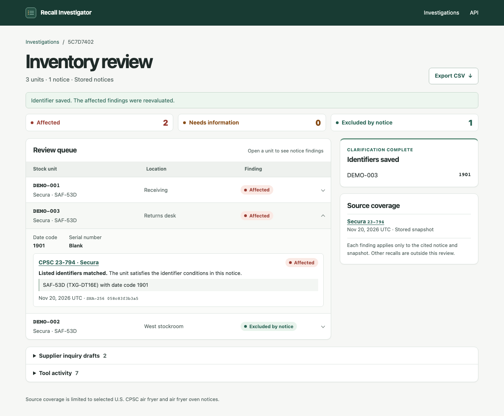

# Three-minute demo

## 0:00 to 0:45 | Start a review

```sh
make setup
make demo
```

Open [localhost:8000](http://127.0.0.1:8000). Choose **Open sample investigation**. Alternatively, download the sample CSV, upload it, select Secura, and leave the source mode on **Stored notices**. All three inventory rows are synthetic.

| Unit | Model | Date code | Initial finding |
| --- | --- | --- | --- |
| DEMO-001 | SAF-53D | 1901 | Affected by notice 23-794 |
| DEMO-002 | SAF-53D | 1903 | Excluded by notice 23-794 |
| DEMO-003 | SAF-53D | Missing | Needs information |

## 0:45 to 1:30 | Inspect evidence

Expand the first two units. Their evidence comes from the Secura description and shows that SAF-53D and its alias TXG-DT16E require code 1901. Code 1903 belongs to the separate SAF-53 and TXG-DS16 group. Open **Tool activity** to see discovery, notice reading, matching, draft preparation, and the date-code request. [Official Secura notice](https://www.cpsc.gov/Recalls/2023/Secura-Recalls-Air-Fryers-Due-to-Fire-and-Burn-Hazards-Recall-Alert)

## 1:30 to 2:30 | Restart and answer

Keep the review tab open. Stop the server with Ctrl+C and run `make demo` again from the same checkout. Reload the review tab. Enter `1901` for DEMO-003 and select **Save and resume**. Expand the unit to see its updated affected finding and original source evidence. Tool activity shows one dependent unit-notice pair reevaluated.



## 2:30 to 3:00 | Export and discuss scope

Download **Export CSV** and inspect the row for DEMO-003. It includes the saved answer, notice ID, snapshot timestamp, source hash, and evidence. Open **Supplier inquiry drafts** to download the draft text. The three statuses describe the Secura snapshot used in this demo. To see cross-notice coverage, upload the same file and select **All three supported notices**.
